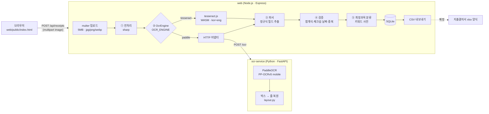

# AI OCR Pipeline — 영수증 자동 입력·검증

영수증 이미지를 올리면 **전처리 → OCR → 필드 추출 → 검증 → 계정과목 분류 → 저장**까지 자동으로 처리하고, 확신이 없는 건만 `REVIEW_REQUIRED`로 골라 사람이 검토한 뒤 지출결의서용 CSV로 내보냅니다.

- **web** (Node.js / Express): 업로드 API, 파싱·검증 파이프라인, SQLite 저장, 검토 화면, CSV 내보내기
- **ocr-service** (Python / FastAPI): PaddleOCR 기반 OCR 엔진 서비스
- OCR 엔진은 환경 변수 하나(`OCR_ENGINE`)로 바꿀 수 있습니다. Python 없이 Node만으로도 실행됩니다(tesseract.js).

| 가상 샘플 5장 기준 | 가맹점 | 일자 | 합계 | 처리시간 | 최대 메모리 |
|---|---|---|---|---|---|
| tesseract.js (Node 내장) | 5/5 | 5/5 | 3/5 | 0.3초/건 | 128MB |
| **PaddleOCR (ocr-service)** | 5/5 | 5/5 | **5/5** | 4.7초/건 | 477MB (+ Node 66MB) |

> 측정 조건과 한계는 [벤치마크](#7-벤치마크)를 참고하세요. 샘플이 5장뿐이라 일반적인 인식률을 나타내는 수치는 아닙니다.

## 1. 문제 정의

총무·경리 담당자는 매달 수십~수백 장의 종이/사진 영수증을 손으로 옮겨 적어 지출결의서를 만듭니다.

- **반복 입력**: 가맹점, 일자, 공급가액, 부가세, 합계를 영수증마다 엑셀에 다시 타이핑합니다.
- **검증 누락**: 합계 불일치, 잘못된 사업자번호, 중복 제출된 영수증을 사람이 눈으로 찾아야 합니다.
- **분류 편차**: 같은 지출도 담당자에 따라 식대·접대비 등 계정과목이 다르게 들어갑니다.
- **개인정보 위험**: 카드번호가 찍힌 원본 이미지가 공유 폴더와 메일에 오래 남습니다.

이 프로젝트는 입력을 자동화하고, **확신이 없는 건만 골라내** 사람이 그 건만 확인하게 만드는 것을 목표로 합니다.

## 2. 시스템 구성



| 단계 | 위치 | 내용 |
|---|---|---|
| ① 전처리 | [web/src/services/preprocess.js](web/src/services/preprocess.js) | EXIF 회전 → 긴 변 ≤1800px → grayscale → normalize → sharpen → (선택) 이진화 |
| ② OCR | [web/src/services/ocrService.js](web/src/services/ocrService.js) | 순차 큐(동시 1건)로 엔진 호출. `tesseract` 또는 `paddle`(HTTP) |
| ② OCR (Python) | [ocr-service/app/](ocr-service/app/) | PaddleOCR 추론 후, 같은 줄의 박스(`합계` / `14,000`)를 좌표로 묶어 줄 단위 텍스트로 복원 |
| ③ 파싱 | [web/src/services/parser.js](web/src/services/parser.js) | O→0, l/I→1, S→5 보정, 날짜·시간 붙음 분리, 가맹점·사업자번호·일자·금액·결제수단 추출, 카드번호 마스킹 |
| ④ 검증 | [web/src/services/validator.js](web/src/services/validator.js) | 합계식, 사업자번호 체크섬, 날짜 범위, 필수 필드, 중복 → 신뢰도·상태 |
| ⑤ 분류 | [web/src/services/categorizer.js](web/src/services/categorizer.js) | 가맹점명·본문 키워드 점수로 계정과목 결정 |
| 저장/출력 | [web/src/db/repository.js](web/src/db/repository.js), [exporter.js](web/src/services/exporter.js) | SQLite 저장, 검토 후 수정(PATCH), CSV(UTF-8 BOM) |

### 왜 Python 서비스를 분리했나

- 한국어 인식에 강한 OCR 모델(PaddleOCR)과 이미지 처리(OpenCV) 생태계가 Python 쪽에 있습니다.
- OCR은 메모리를 많이 쓰고 느리므로, 웹 서버와 프로세스를 분리해 두면 따로 재시작·확장할 수 있습니다.
- 두 레이어는 `recognize(image) → { text, confidence }` 계약 하나로만 연결됩니다. Node 쪽은 엔진이 바뀌어도 파서·검증 코드를 고치지 않습니다.

### 확장 구조 (실제 구현 범위)

- **OCR 엔진**: `OcrEngine` 인터페이스(`init / recognize / terminate`)와 어댑터 2개(`createTesseractEngine`, `createHttpEngine`)가 구현되어 있고, `createEngine(name)`이 환경 변수로 하나를 고릅니다. 새 엔진(예: 클라우드 OCR)은 어댑터 하나를 추가하면 됩니다.
- **문서 종류**: 현재는 **영수증 한 종류**만 처리합니다. 문서 종류별로 파서·검증 규칙을 바꾸는 구조는 아직 없습니다([로드맵](#9-한계와-로드맵) 참고).

## 3. 영수증 처리 규칙

| 항목 | 규칙 |
|---|---|
| 합계 선택 | 키워드 줄 우선. `결제금액/승인금액/받을금액/청구금액` > `합계/총액/합계금액/TOTAL`. 같은 등급이 여러 개면 가장 큰 금액. 키워드가 없으면 번호류 줄(승인번호·전화 등)을 뺀 전체에서 가장 큰 금액 |
| 금액 검증 | `공급가액 + 부가세 = 합계` (±1원 허용). 둘 중 하나라도 없으면 건너뜀 |
| 사업자번호 | 가중치 `1,3,7,1,3,7,1,3,5` 체크섬 |
| 날짜 | 미래 날짜 불가, 5년 이내 |
| 신뢰도 | `confidence = OCR 신뢰도 × 0.4 + 검증 통과율 × 0.6` |
| 합계 근거 | 합계 키워드를 못 찾아 가장 큰 금액으로 추정했거나, 키워드 줄의 금액 형식이 깨져 있으면(`22.5002` 등) `TOTAL_UNCERTAIN` |
| 상태 | `confidence < 0.75`, 필수 필드(가맹점·일자·합계) 누락, 중복, `TOTAL_UNCERTAIN` 중 하나면 `REVIEW_REQUIRED`, 아니면 `CONFIRMED` |
| 중복 | `sha256(공백 제거·소문자 가맹점 \| 일자 \| 합계)`가 DB에 이미 있으면 `duplicate=true` |
| 계정과목 | `식대 · 교통비 · 사무용품 · 접대비 · 통신비 · 기타`. 키워드는 [categorizer.js](web/src/services/categorizer.js) 상단 사전에서 수정 |

**개인정보 처리**
- 업로드한 원본 이미지는 처리가 끝나면 성공·실패와 관계없이 바로 삭제합니다(`finally`에서 `unlink`).
- 카드번호는 끝 4자리(`card_last4`)만 저장합니다. DB에 저장하는 OCR 원문에서도 카드번호는 끝 4자리만 남기고 `*`로 바꿉니다.
- 저장소의 샘플 이미지와 테스트 데이터는 모두 가상 값입니다(아래 [샘플](#6-입출력-예시) 참고).

## 4. 기술 스택

| 영역 | 사용 기술 |
|---|---|
| web | Node.js 22+, Express 5, multer, zod 4, sharp, tesseract.js 7, better-sqlite3, dotenv |
| ocr-service | Python 3.12, FastAPI, uvicorn, PaddleOCR 3.7 (PP-OCRv5 mobile det + korean rec), paddlepaddle 3.3 (CPU), OpenCV, psutil |
| 테스트 | `node:test` (단위·API 46개), pytest (9개) |
| 프론트엔드 | 단일 HTML + vanilla JS (빌드 없음) |

```
ai-ocr-pipeline/
├─ web/                    Node.js 웹/API 레이어
│  ├─ src/
│  │  ├─ server.js         진입점 (엔진 선택, 기동)
│  │  ├─ app.js            Express 조립
│  │  ├─ config.js         환경 변수
│  │  ├─ routes/           REST API
│  │  ├─ services/         preprocess · ocrService · parser · validator · categorizer · exporter · pipeline
│  │  └─ db/               SQLite repository
│  ├─ public/index.html    검토 화면
│  ├─ scripts/             benchmark.js, make-samples.js
│  └─ tests/
├─ ocr-service/            Python OCR 서비스
│  ├─ app/                 main.py(FastAPI) · engine.py(PaddleOCR) · layout.py(줄 복원) · config.py
│  └─ tests/
└─ samples/                가상 영수증 이미지 + 정답 JSON
```

## 5. 설치 및 실행 (Windows / PowerShell)

필요 환경: **Node.js 22 이상**, (PaddleOCR 사용 시) **Python 3.12**

> **주의**: 저장소를 **한글 등 비ASCII 문자가 없는 경로**에 두세요(예: `D:\projects\ai-ocr-pipeline`). PaddleOCR의 C++ 추론기는 비ASCII 경로의 모델 파일을 열지 못합니다. 모델 캐시는 사용자 폴더 대신 `ocr-service\.paddlex`에 저장하도록 되어 있어서 Windows 사용자명이 한글이어도 괜찮습니다.

### 5-1. web (Node.js) — 이것만으로도 실행됩니다

```powershell
cd web
npm ci

# tesseract.js 언어 파일 (약 6MB, 처음 한 번). tessdata 폴더는 저장소에 없으니 먼저 만든다
New-Item -ItemType Directory -Force tessdata | Out-Null
Invoke-WebRequest -Uri https://github.com/tesseract-ocr/tessdata_fast/raw/main/kor.traineddata -OutFile tessdata\kor.traineddata
Invoke-WebRequest -Uri https://github.com/tesseract-ocr/tessdata_fast/raw/main/eng.traineddata -OutFile tessdata\eng.traineddata

copy .env.example .env   # 선택. 기본값으로도 동작
npm start                # http://localhost:3000
```

- `web/.npmrc`에 `ignore-scripts=true`가 들어 있습니다. better-sqlite3는 Windows용 바이너리를 패키지에 포함하는데, npm 11이 소스 빌드(node-gyp)를 시도해 Visual Studio가 없는 PC에서 설치가 실패하기 때문입니다.
- `npm run dev`(자동 재시작), `npm test`, `npm run benchmark`, `npm run make-samples`

### 5-2. ocr-service (Python, PaddleOCR) — 선택

```powershell
cd ocr-service
python -m venv .venv
.venv\Scripts\python -m pip install -r requirements.txt      # 약 900MB

# 첫 기동 때 PP-OCRv5 mobile 모델(약 20MB)을 ocr-service\.paddlex 에 내려받습니다
.venv\Scripts\python -m uvicorn app.main:app --host 127.0.0.1 --port 8000
# 확인: http://127.0.0.1:8000/health → {"ok": true, ...}
```

테스트: `.venv\Scripts\python -m pip install -r requirements-dev.txt` 후 `.venv\Scripts\python -m pytest`

### 5-3. web을 PaddleOCR로 연결

ocr-service를 띄운 상태에서 `web\.env`에 `OCR_ENGINE=paddle`을 넣거나, 실행할 때 지정합니다.

```powershell
cd web
$env:OCR_ENGINE='paddle'; npm start
```

| 변수 (web) | 기본값 | 설명 |
|---|---|---|
| `PORT` | `3000` | 포트 |
| `OCR_ENGINE` | `tesseract` | `tesseract` \| `paddle` |
| `OCR_SERVICE_URL` | `http://127.0.0.1:8000` | ocr-service 주소 |
| `OCR_CONFIDENCE_THRESHOLD` | `0.75` | 검토 필요 판정 임계값 |
| `OCR_THRESHOLD` | (off) | `on`이면 전처리에 이진화 적용 |
| `DB_FILE` | `web/data/receipts.db` | SQLite 경로 |

ocr-service 변수는 [ocr-service/.env.example](ocr-service/.env.example)에 있습니다.

## 6. 입출력 예시

[samples/](samples/)의 이미지는 [web/scripts/make-samples.js](web/scripts/make-samples.js)로 생성한 **가상 영수증**입니다. 상호·전화번호·카드번호는 가짜이고, 사업자번호는 체크섬만 맞춘 `999-` 대역의 가상 번호입니다. 4장에는 회전·블러·대비 저하·JPEG 압축을 넣어 사진으로 찍은 영수증을 흉내 냈습니다.

| 파일 | 특징 |
|---|---|
| `receipt01_cafe.png` | 공급가액/부가세/합계, 카드번호 마스킹 |
| `receipt02_stationery.jpg` | 슬래시 날짜, 할인 후 `결제금액` 우선, 1.5° 회전 |
| `receipt03_taxi.jpg` | 2자리 연도(`26.10.15`), `받을금액`, 블러 |
| `receipt04_restaurant.jpg` | `과세물품가액`, -2.5° 회전 + 블러 + 대비 저하 |
| `receipt05_convenience.jpg` | 한글 날짜(년월일), 현금, 거스름돈 함정 |

```powershell
curl.exe -F "image=@samples/receipt03_taxi.jpg" http://localhost:3000/api/receipts
```

입력 `samples/receipt03_taxi.jpg` → 출력 (`OCR_ENGINE=paddle`, `rawText` 생략):

```json
{
  "data": {
    "id": 1,
    "status": "CONFIRMED",
    "merchant": "가상운수 개인택시",
    "bizNo": "999-22-00003",
    "date": "2026-10-15",
    "time": "23:41",
    "totalAmount": 18300,
    "supplyAmount": null,
    "vat": null,
    "paymentMethod": "카드",
    "cardLast4": null,
    "category": "교통비",
    "confidence": 0.989,
    "ocrConfidence": 0.9716,
    "duplicate": false,
    "issues": [],
    "valid": true
  }
}
```

CSV 내보내기(`GET /api/receipts/export.csv`):

```csv
일자,가맹점,계정과목,공급가액,부가세,합계,상태
2026-10-15,가상운수 개인택시,교통비,,,18300,확정
```

### API

모든 에러 응답 형식: `{ "error": { "code": "...", "message": "...", "details": [...]? } }`

| 메서드 | 경로 | 설명 |
|---|---|---|
| `POST` | `/api/receipts` | multipart 필드 `image`. 처리 후 `201 { data: Receipt }` |
| `GET` | `/api/receipts?status=&from=&to=&category=` | 목록 (일자 내림차순) |
| `GET` | `/api/receipts/:id` | 상세 |
| `PATCH` | `/api/receipts/:id` | 수정 후 재검증. `confirm: true`면 필수 필드가 있을 때 `CONFIRMED`로 확정 |
| `GET` | `/api/receipts/export.csv?from=&to=` | 지출결의서 CSV (UTF-8 BOM) |
| `GET` | `/api/health` | 상태 및 OCR 대기 건수 |

에러 코드: `FILE_REQUIRED`(400), `INVALID_FILE_TYPE`(400), `FILE_TOO_LARGE`(413), `INVALID_IMAGE`(422), `VALIDATION_ERROR`(400), `NOT_FOUND`(404), `INTERNAL_ERROR`(500)
검증 이슈 코드: `MISSING_FIELDS`, `AMOUNT_MISMATCH`, `INVALID_BIZ_NO`, `FUTURE_DATE`, `DATE_TOO_OLD`, `DUPLICATE`, `TOTAL_UNCERTAIN`

ocr-service: `GET /health` → `{ ok, engine, peakRssMb }`, `POST /ocr`(multipart `image`) → `{ text, confidence, lines: [{ text, confidence, bbox }] }`

## 7. 벤치마크

```powershell
cd web
npm run make-samples                          # samples/ 재생성
npm run benchmark -- --engine tesseract       # 전처리 ON
npm run benchmark -- --engine paddle          # ocr-service 실행 중이어야 함
npm run benchmark -- --engine paddle --no-preprocess
```

측정 환경: Intel Core i7-1165G7, RAM 8GB, Windows 10, Node 24, Python 3.12, CPU만 사용

| 엔진 | 전처리 | 가맹점 | 일자 | 합계 | 평균 처리시간 | 최대 메모리 |
|---|---|---|---|---|---|---|
| tesseract.js | ON | 5/5 | 5/5 | 3/5 | 328ms | 128MB |
| tesseract.js | OFF | 5/5 | 5/5 | 4/5 | 291ms | 136MB |
| PaddleOCR | ON | 5/5 | 5/5 | 5/5 | 4,673ms | ocr-service 477MB + web 66MB |
| PaddleOCR | OFF | 5/5 | 5/5 | 5/5 | 3,825ms | ocr-service 477MB + web 62MB |

- tesseract.js는 합계 2건을 틀렸습니다. 할인 후 결제금액 22,500원 영수증을 `22`로, 거스름돈이 있는 편의점 영수증(총액 3,500원)을 `50001`로 추출했습니다.
  - 처음에는 이 2건이 신뢰도 0.94로 `CONFIRMED`가 됐습니다. 공급가액·부가세가 없는 영수증은 합계식 검증을 건너뛰기 때문입니다. 원인은 각각 `결제금액 = 22.5002)`(쉼표가 마침표로 깨짐)와 `총액`→`종액` 오인식(키워드 없음 → 가장 큰 숫자인 `500ml`→`50001` 선택)이었습니다. 합계 근거 검사(`TOTAL_UNCERTAIN`)를 추가해 지금은 두 건 모두 `REVIEW_REQUIRED`로 분류됩니다. 정답 3건과 PaddleOCR 5건은 그대로 `CONFIRMED`입니다.
- PaddleOCR는 정확하지만 CPU에서 건당 4~5초가 걸리고, 두 프로세스를 합쳐 tesseract.js보다 메모리를 4배 이상 씁니다. 그래서 기본값은 tesseract.js로 두고 PaddleOCR는 선택 사항으로 했습니다.
- PaddleOCR 연동 초기에는 일자 정확도가 3/5였습니다. 한 박스 안의 공백이 빠져 `2026-10-2712:34:56`처럼 날짜와 시간이 붙어 나왔기 때문입니다. 파서에 날짜·시간 분리 규칙(`splitDateTime`)을 추가해 5/5가 됐습니다.
- **한계**: 합성 이미지 5장이라 실제 영수증 사진(구김, 그림자, 감열지 변색) 성능을 대표하지 않습니다.

## 8. 테스트

```powershell
cd web; npm test                                  # 46개: 파서 fixture 9종, 검증, 전처리, OCR 큐/HTTP 어댑터, API
cd ocr-service; .venv\Scripts\python -m pytest    # 9개: 줄 복원 로직, API (가짜 엔진)
```

## 9. 한계와 로드맵

**현재 한계**
- 문서 종류는 영수증 하나입니다. 지출결의서는 입력 문서가 아니라 CSV 출력 형식으로만 지원합니다.
- 파서는 줄 단위 정규식 규칙이라 품목·수량·금액이 열로 나뉜 표 형태 영수증에 약합니다.
- 기울기 보정(deskew)과 영수증 영역 자동 크롭이 없습니다.
- 계정과목 분류는 키워드 기반이라 식대와 접대비처럼 업종만으로 구분되지 않는 경우를 판단하지 못합니다.
- 중복 판정은 가맹점명 문자열에 의존하므로, OCR이 가맹점명을 다르게 읽으면 같은 영수증을 중복으로 잡지 못합니다.
- 인증·다중 사용자 기능이 없는 로컬용 서버입니다.

**로드맵**
1. **컨테이너화**: web / ocr-service 각각 Dockerfile + `docker compose`로 한 번에 기동
2. **문서별 처리 구조**: `DocumentProcessor { parse, validate, categorize }` 인터페이스로 영수증·세금계산서·거래명세서 등 문서 종류별 규칙 분리 (전략 패턴)
3. **ML 모델 추가 (ocr-service)**: 문서 종류 자동 분류, 금액·빈도 기반 이상 지출 탐지
4. **인식률 평가 지표**: 실제 영수증(비식별화) 평가셋 구축, 필드별 정확도·CER 자동 리포트
5. **레이아웃 분석**: ocr-service가 이미 돌려주는 줄 bbox(`lines`)로 표 영수증의 품목·수량·금액 열 복원
6. 전처리 강화(deskew, 적응형 이진화), 지출결의서 xlsx 양식 직접 출력

## 10. 라이선스

[MIT](LICENSE)
